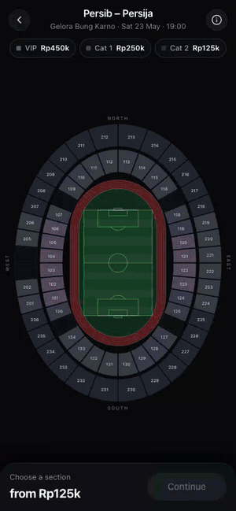

# 3D Stadium Seat Selector

An interactive mobile-first stadium seat selection web app featuring a continuous **ray-pinned exponential zoom-in with optical fast-blur** from the 2D stadium seat map directly into an interactive **Three.js 3D first-person view** from your exact seat inside **Gelora Bung Karno Main Stadium (SUGBK), Jakarta**.

**Live Demo:** [https://www.agusibrah.im/stadion-seat-selector/](https://www.agusibrah.im/stadion-seat-selector/)

<p align="center">
  
</p>

> High-resolution MP4 preview: [`docs/demo.mp4`](docs/demo.mp4)

---

## How It Works

1. **Stage 1 — 2D Olympic Oval Map**
   - Parametric 36-sector elliptical bowl (`101–136` Lower Tier, `201–236` Upper Tier) mapped across Gelora Bung Karno's official **Zones 1–12**, complete with the iconic 8-lane brick-red 400m athletics track, FIFA pitch markings, marathon gate tunnels, and category filtering (`VIP`, `Cat 1`, `Cat 2`).
2. **Stage 2 — Auto-Orienting Section Seat Picker**
   - Tapping any section smoothly rotates and zooms the vector map so the pitch is always oriented directly upward (`^ PITCH`), displaying individual available/taken seats with touch-ripple feedback.
3. **Stage 3 — Ray-Pinned 2D↔3D Real Zoom & First-Person POV**
   - Pressing **Continue** measures the selected 2D seat's exact screen coordinates and drives a synchronized **1x → ~10x perspective zoom** + **32-tap jittered GLSL radial/directional motion blur** locked sub-pixel onto your numbered 3D stadium chair (`#F5CA37`) before settling into seated eye level.
   - Inside the 3D bowl: ~32,000 `InstancedMesh` **Merah–Putih (Red & White) wave-mosaic seats**, SUGBK's radial-ribbed *Temu Gelang* roof canopy, 360° floodlight ring, dual jumbotrons (`19:00 · PERSIB — PERSIJA`), inertial panoramic drag-to-look, a live-synced sightline mini-map, and real-time Euclidean distances (`to the centre spot`, `to the nearest goal`, `above the pitch`).
   - **Native Mobile Adaptive:** Automatically hides the desktop mockup status bar/bezel on real phones (`100vw × 100dvh` with `safe-area-inset` support, mobile GPU resolution scaling, and OS hardware/swipe-back navigation).

---

## Tech Stack

- **UI & State:** React 19, TypeScript, Tailwind CSS v4, Vite 6
- **3D Engine & Shaders:** Three.js (`InstancedMesh`, custom GLSL sky dome & 32-tap Interleaved Gradient Noise motion-blur post-processing)

## Project Structure

```text
src/
├── types/stadium.ts                # Domain types (Section, Seat, Category, SpatialMetrics)
├── data/
│   ├── matchInfo.ts                # Match metadata & ticket categories (Persib – Persija)
│   └── stadiumConfig.ts            # 36-sector / 12-Zone SUGBK elliptical bowl topology
├── geometry/
│   ├── bowlCurve.ts                # Quarter-ellipse arc-length curve & 2D SVG polygons
│   ├── seatLayout.ts               # Deterministic 1-to-1 seat generator & row anchors
│   ├── spatialMetrics.ts           # 3D world meter coordinates & Euclidean distance math
│   └── rayPinnedCamera.ts          # 360° orthonormal ray-pinned exponential zoom & head-look
├── three/
│   ├── StadiumSceneManager.ts      # Persistent WebGL controller & 60fps 2D/3D lockstep sync
│   ├── effects/ZoomBlurPass.ts     # 32-tap jittered GLSL optical zoom + sweep motion blur
│   └── builders/                   # Sky/lights, GBK track & pitch, Merah-Putih bowl, Temu Gelang roof
└── components/
    ├── layout/                     # MobileViewport, TopHeader, BottomActionBar, MatchInfoModal
    ├── map2d/                      # StadiumMapCanvas, PitchSvg, SectionSeatGrid
    └── view3d/                     # SeatPovStage, SeatDetailSheet, StadiumMiniMap
```

## Getting Started

```bash
# Install dependencies
bun install   # or: npm install

# Start development server
bun run dev   # or: npm run dev

# Typecheck & build for production
bun run build
```

## Credits

Inspired by the stadium seat selector concept by **Ramin Nasibov** ([x.com/RaminNasibov](https://x.com/i/status/2122433340250718529)).
